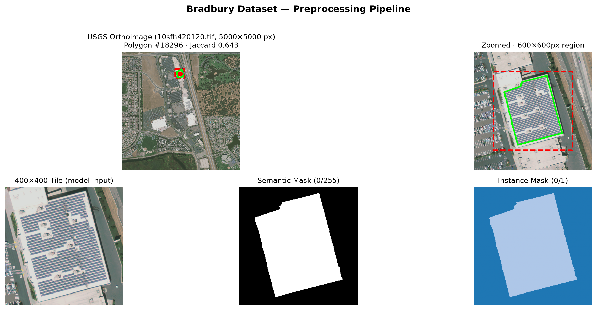
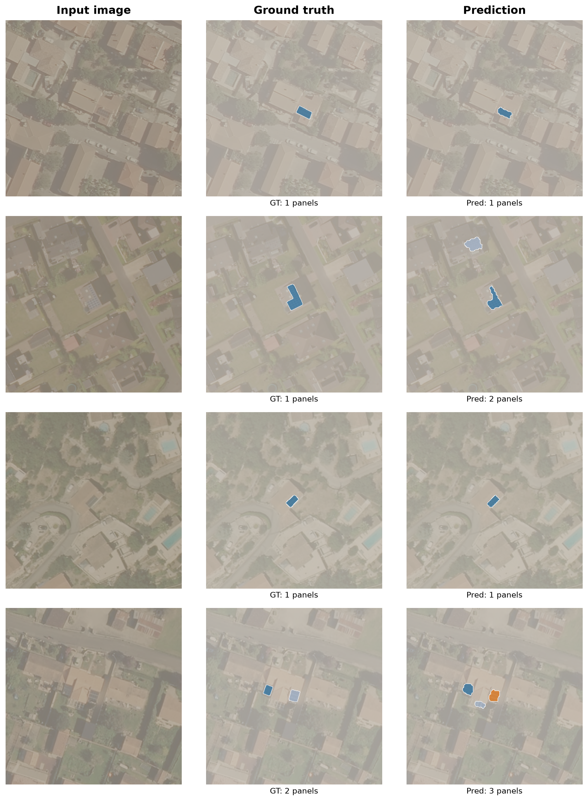

<!-- _class: lead -->

# Panoptic Segmentation of Solar Panels from Aerial Imagery

### An end-to-end deep learning pipeline

<span class="small">Data → Mask2Former → evaluation · PyTorch Lightning · Hydra · MLflow</span>

---

## The problem

- Distributed solar (rooftop + ground-mount) is growing fast
- Utilities, planners, and researchers need an **accurate, up-to-date inventory** of where panels are
- **Manual annotation of aerial imagery doesn't scale** — millions of tiles to review
- Downstream uses: grid-impact studies, adoption trends, incentive policy, siting analysis

**Goal:** automatically **detect and delineate every solar panel** from aerial / satellite imagery.

---

## The task: panoptic segmentation

Three related tasks, increasing difficulty:

| Task | Question it answers |
|------|---------------------|
| Semantic segmentation | *Which pixels are solar panels?* |
| Instance segmentation | *Which panel is which?* (separate touching panels) |
| **Panoptic segmentation** | **Both at once** — class per pixel **+** a unique ID per panel |

We solve **panoptic**: it gives both a coverage map **and** a panel count per scene.

---

## Dataset example


<span class="small">Bradbury (Fresno) — 7 annotated panels in one 5000×5000 scene; each is extracted as a separate 400×400 tile.</span>

---

## Data

| Dataset | Region | Imagery | Annotations | GSD | License |
|---------|--------|---------|-------------|-----|---------|
| **Bradbury** (2016) | California, US | 601 orthos (5000×5000) | 19.8K polygons | 0.3 m | CC0 |
| **BDAPPV** (2023) | France | 46K tiles (400×400) | 21K masks | 0.1–0.2 m | CC-BY |

- **Bradbury:** vector polygons → tile into 400×400 crops centred on each panel
- **BDAPPV:** binary masks → connected-component labelling to recover instances
- Two very different domains (resolution, geography, annotation style) — good for testing robustness

---

## Preprocessing pipeline



<span class="small">5000×5000 orthoimage → polygon annotation → 400×400 tile → semantic mask (0/255) → instance mask.</span>

---

## Model: Mask2Former

- **Universal segmentation** architecture (Cheng et al., CVPR 2022)
- **Masked-attention transformer decoder** predicts a set of *(mask, class)* pairs — like DETR, no anchors / NMS
- Backbone: **Swin Transformer** (hierarchical vision transformer), pre-trained on COCO-panoptic
- We fine-tune end-to-end, replacing the head for **2 classes** (background, panel)
- Loss = cross-entropy (class) **+** Dice **+** sigmoid-focal (mask), summed with **auxiliary deep supervision** at every decoder layer

<span class="small">Swin-T / -B / -L differ only in backbone size — the decoder head is identical.</span>

---

## Training procedure

- **Framework:** PyTorch Lightning + HuggingFace Transformers
- **Config:** Hydra (composable YAML) · **Tracking:** MLflow · **Data versioning:** DVC
- **Precision:** bf16-mixed · **Hardware:** 1× A100 (40 GB)
- **Optimizer:** AdamW, lr 3e-5, cosine decay, 500-step warmup, wd 0.01
- **Augmentation:** horizontal flip, colour jitter, Gaussian blur
- **Selection:** checkpoint + early stopping on validation loss

<span class="small">Every run is seeded and reproducible; ~13 min / epoch on one A100.</span>

---

## Evaluation metrics

**mIoU** (semantic): mean over classes of the intersection-over-union of pixels.

**Panoptic Quality (PQ)** — the standard metric, with a clean decomposition:

$$\text{PQ} = \text{SQ} \times \text{RQ}$$

- **SQ** — *Segmentation Quality:* mean IoU of matched panels → **boundary accuracy**
- **RQ** — *Recognition Quality:* F1-like detection score → **did we find the panels?**
- A predicted panel counts as a **true positive** only if its `IoU > 0.5`

<span class="small">PQ is the honest number — mIoU is flattered by the large, easy background class.</span>

---

## Experiment: backbone scaling

Identical config, only the Swin backbone changes. **Full BDAPPV test set (~3,148 images).**

| Backbone | Params | **PQ** | SQ | RQ | mIoU | test loss |
|----------|--------|--------|-----|-----|------|-----------|
| Swin-T | 47 M | 0.712 | 0.772 | 0.891 | 0.861 | 8.22 |
| Swin-B | 110 M | 0.694 | 0.771 | 0.869 | 0.850 | 8.02 |
| Swin-L | 216 M | **0.714** | 0.774 | 0.891 | 0.861 | **7.89** |

- **Swin-T ≈ Swin-L** (statistical tie) — both clearly above **Swin-B**
- A 47 M-parameter model matches one 4.6× larger

---

## Key finding: loss ≠ segmentation quality

```
test loss:   T 8.22  →  B 8.02  →  L 7.89     (monotonic  ↓  with size)
PQ:          T 0.712 →  B 0.694 →  L 0.714    (non-monotonic)
```

- Loss improves monotonically with model size — **panoptic quality does not**
- **SQ is flat** (0.771–0.774) across all sizes → panel *shape* segmentation is saturated
- All differences live in **RQ** (detection) → the real lever is *finding* panels, not outlining them
- **Lesson:** for segmentation, don't select models on loss alone — measure PQ directly

---

## Predictions from the trained model



<span class="small">Input · ground truth · model prediction (each panel a distinct colour).</span>

---

## Takeaways & next steps

**Delivered**
- End-to-end pipeline: multi-dataset data → Mask2Former fine-tuning → PQ/SQ/RQ evaluation
- Fully config-driven (Hydra), tracked (MLflow), reproducible
- A small Swin-T matches a much larger Swin-L on panoptic quality

**Next steps**
- Optimise **RQ directly** — confidence-threshold tuning, more instance-rich data (Bradbury)
- **Cross-domain transfer:** train on France (BDAPPV), evaluate on California (Bradbury)
- **Live acquisition:** on-demand imagery via Google Earth Engine / Sentinel Hub APIs

---

<!-- _class: lead -->

# Questions?
